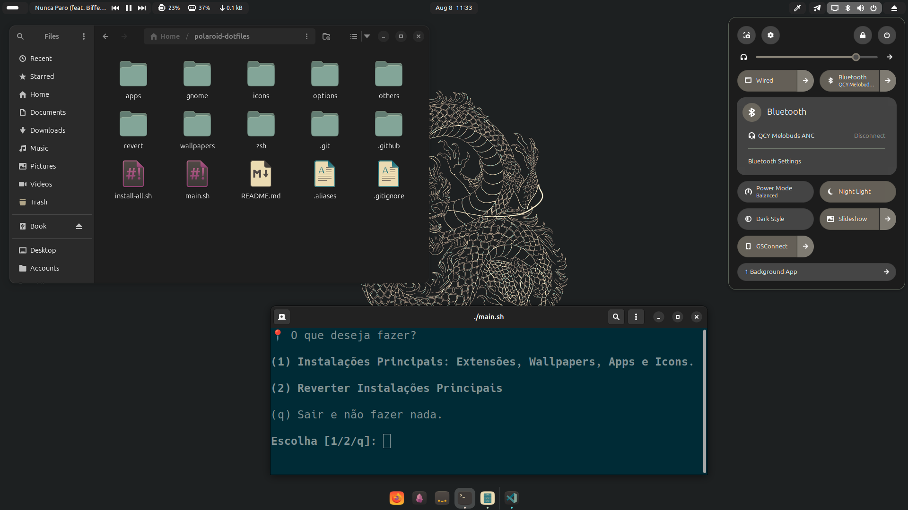
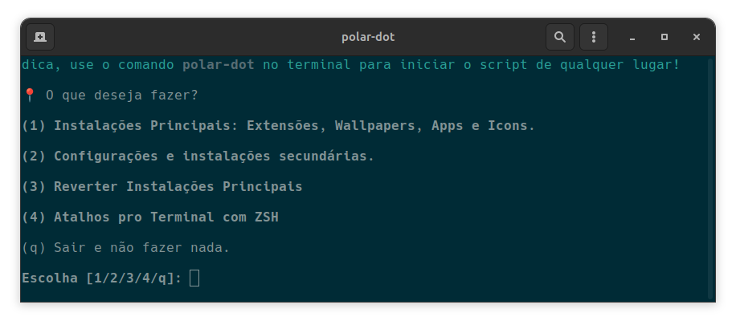

<h1 align="center">
  ✨ Polaroid-Dotfiles ✨
</h1>

<p align="center">
  
  
  
</p>

<p align="center">
  
</p>

<p align="center">
  <a href="#-instalação">Instalação</a> ·
  <a href="#-o-que-o-script-configura">Funcionalidades</a> ·
  <a href="#-comandos-e-uso">Uso</a> ·
  <a href="#-reversão">Reversão</a>
</p>

## 📝 Sobre o projeto

O `polaroid-dotfiles` é um conjunto de scripts Bash para preparar e personalizar um desktop **Ubuntu 24.04 LTS com GNOME/Wayland**. Ele reúne tarefas de pós-instalação em um menu interativo: wallpapers, ícones Gruvbox, extensões GNOME, aplicativos, terminal e pequenos ajustes de usabilidade.

O projeto foi criado para tornar uma reinstalação mais rápida e reproduzível, sem esconder as etapas: cada ação pode ser executada separadamente pelo menu e pede confirmação quando apropriado.

## ✨ O que o script configura

### Instalações principais

- **Wallpapers:** extrai o pacote de wallpapers incluído no repositório.
- **Tema e ícones:** baixa o tema [Gruvbox Plus Dark](https://github.com/SylEleuth/gruvbox-plus-icon-pack), aplica o modo escuro do GNOME e restaura os atalhos de aplicativos com ícones personalizados.
- **Extensões GNOME:** baixa as extensões compatíveis com a versão atual do GNOME Shell, compila seus schemas, ativa as extensões e restaura as configurações salvas.
  - AzWallpaper
  - ArcMenu
  - Blur my Shell
  - Color Picker
  - Dash to Dock
  - GSConnect
  - Just Perfection
  - Media Controls
  - Open Bar
  - Removable Drive Menu
  - System Monitor
  - Top Bar Organizer
  - User Themes
- **Dependências das extensões:** antes da instalação das extensões, instala `gir1.2-gtop-2.0` e `libgtop2-dev`, necessárias para o System Monitor.
- **Aplicativos:** instala automaticamente os itens das listas em [`apps/flatpaks.list`](apps/flatpaks.list) e [`apps/snaps.list`](apps/snaps.list). Se necessário, configura Flatpak/Flathub e Snap.

| Origem | Aplicativos atuais |
| --- | --- |
| Flatpak | ZapZap, Extension Manager, Obsidian, Warehouse, Add Water, A Photo Tool (libre), Ear Tag, Secrets, G4Music e Junction |
| Snap | Dialect e Thunderbird |

### Ferramentas extras

- Instalação do **GNOME Tweaks**.
- Instalação do **Fastfetch**.
- Instalação e configuração de **Zsh**, Oh My Zsh e Powerlevel10k, usando os arquivos de configuração deste repositório.
- Instalação da **Hack Nerd Font** para uso no terminal.
- Alternância entre **GNOME Console** e **GNOME Terminal** como terminal padrão, incluindo o atalho `Ctrl` + `Alt` + `T`.
- Criação e restauração de ícones personalizados para apps instalados por Flatpak ou Snap.
- Modo de desenvolvimento "dev" (oculto no menu) para criar backup das configurações das extensões GNOME.

## ⚙️ Pré-requisitos

- Ubuntu 24.04 LTS com GNOME e Wayland.
- Acesso a `sudo`.
- Conexão com a internet.
- Repositório clonado em `~/polaroid-dotfiles`. Alguns atalhos e scripts usam esse caminho.

> A instalação de extensões e a configuração inicial do Flatpak podem solicitar logout. Salve seu trabalho antes de prosseguir e execute o script novamente quando for indicado.

## 💾 Instalação

Clone o repositório no diretório pessoal e execute o menu:

```bash
cd ~
git clone https://github.com/Pol4rLun4r/polaroid-dotfiles.git
cd polaroid-dotfiles
chmod +x main.sh install-all.sh
./main.sh
```

Na primeira execução, são criados os comandos globais `polar-dot` e `dot-install` em `/usr/local/bin`.

## 🎛️ Comandos e uso

| Comando | Ação |
| --- | --- |
| `./main.sh` ou `polar-dot` | Abre o menu interativo. |
| `./install-all.sh` ou `dot-install` | Executa a instalação principal: wallpapers, extensões, ícones e aplicativos. |

O menu principal separa as tarefas em quatro áreas:

1. Instalações principais: wallpapers, extensões, aplicativos, tema/ícones ou tudo de uma vez.
2. Configurações secundárias: GNOME Tweaks, Fastfetch, Zsh, fontes, terminais e ícones de apps.
3. Reversão das instalações principais.
4. Consulta dos atalhos do terminal e comandos globais.

Após instalar o Zsh, os atalhos configurados incluem `c` (limpar o terminal), `update` (atualizar o sistema), `dots` (abrir `~/polaroid-dotfiles`) e `desktop` (abrir `~/Desktop`).

<p align="center">
  
</p>

## 🔄 Reversão

Pelo menu, é possível:

- remover o tema Gruvbox e os atalhos de ícones personalizados;
- remover os wallpapers extraídos;
- desativar e remover as extensões listadas pelo projeto.

Os scripts não removem aplicativos instalados. Faça essa remoção manualmente com Flatpak, Snap ou o gerenciador de pacotes que preferir.

## 🤝 Contribuição

Contribuições são bem-vindas. Faça um fork, crie uma branch para a alteração, teste os scripts no Ubuntu 24.04 e abra um Pull Request explicando a mudança.

## 📄 Licença

Licenciado sob a [MIT License](LICENSE).
